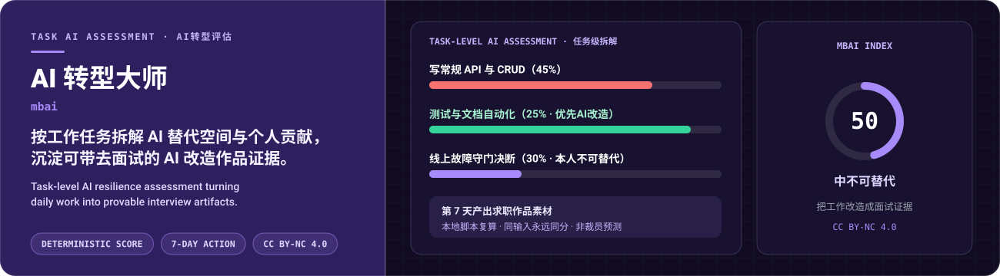
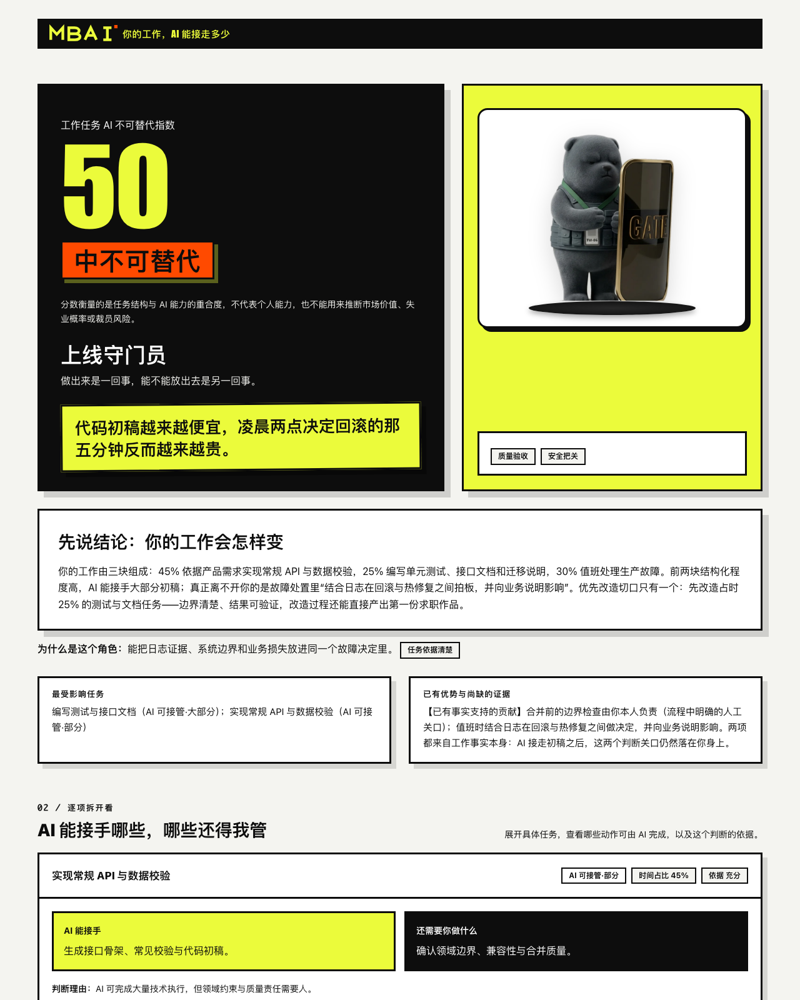
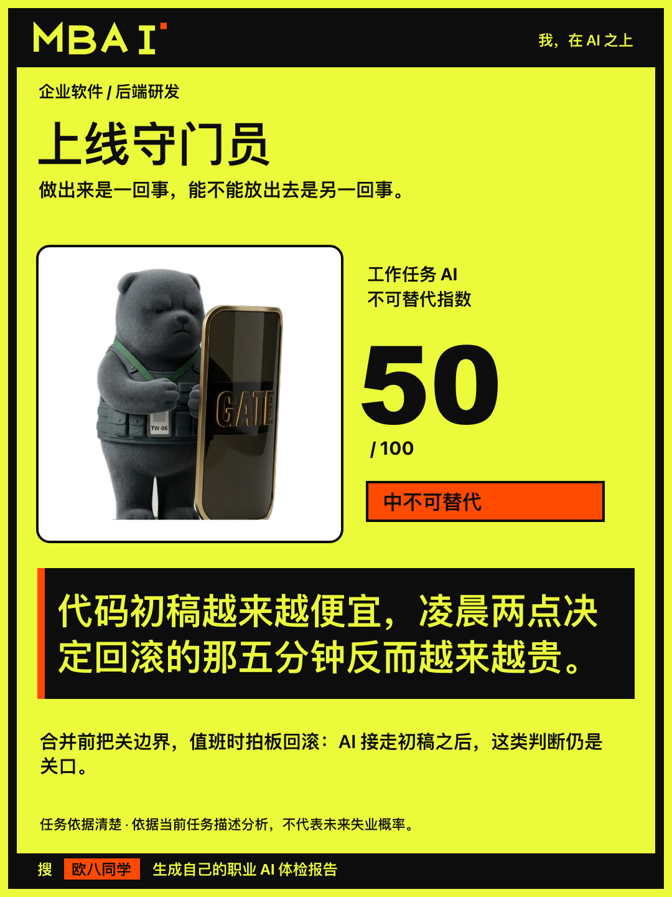

# AI转型大师（mbai）｜MBAI 工作任务 AI 不可替代指数与替代风险自评

<!-- discovery:start -->
## 工作任务 AI 替代风险自评与职业转型

**怎么判断自己的哪些工作适合用 AI，哪些贡献仍要自己负责？** 输入工作任务、简历或工作总结，拆解自动化空间、个人贡献与证据缺口，形成解释性自评和行动建议。

Task-level AI automation risk self-assessment for career planning.

**开始使用：** [两种使用方式](#quick-start) · [工作任务示例](#quick-example)。

**使用边界：** 正式指标为“工作任务 AI 不可替代指数”，用于职业反思；不是裁员预测或就业概率。采用 CC BY-NC 4.0，限非商业使用。

[按任务浏览欧八同学的全部工具](https://github.com/ouxxyy/ouba-classmate#按需求找)；如果本项目有帮助，欢迎收藏当前仓库。

<!-- discovery:end -->

<!-- hero:start -->

<p>
  <a href="https://github.com/ouxxyy/ouba-classmate"></a>
</p>

**拆解你日常工作任务的「AI 不可替代指数」并识别证据缺口，同时支持召唤 4 核 AI 智囊团完成高风险职业决策复盘（用于个人职业反思，非裁员预测）。**  
<sub>Measure task-level AI irreplaceability index and assemble a 4-perspective AI advisory board for career reflection (not a layoff predictor).</sub>

<p>
  <a href="https://github.com/ouxxyy/ouba-classmate"></a>
  <a href="#quick-example"></a>
  <a href="#quick-start"></a>
  <a href="#english-overview"></a>
  <a href="https://github.com/ouxxyy"></a>
</p>

> 🌟 本项目是 [欧八同学旗舰合集 `ouba-classmate`](https://github.com/ouxxyy/ouba-classmate) 的核心组件（11 个原创项目，可[一键安装全部 Skills](https://github.com/ouxxyy/ouba-classmate#install)）。如果它帮到了你，欢迎顺手给 [旗舰主仓库](https://github.com/ouxxyy/ouba-classmate) 点个 Star ⭐ 支持持续更新 ｜ 终端 1 秒加星：`gh api -X PUT /user/starred/ouxxyy/ouba-classmate`


<!-- hero:end -->

提供简历、工作总结或任务描述，MBAI 会拆解工作中的自动化空间、个人贡献和证据缺口，输出解释性自评与行动建议；Skill 路径可生成离线报告。它用于职业反思，不预测失业或裁员。

MBAI（Me, Beyond AI · 我，在 AI 之上）是测评品牌名；正式指标名是「工作任务 AI 不可替代指数」——分数越高，说明你的工作越依赖你本人。

> [!TIP]
> 🎁 扫码关注公众号「欧八同学」，免费领取 AI 案例与 Skill《大厂产品AI经验编程 200 套》→ [去扫码](#author)

[使用示例](#quick-example) · [开始使用](#quick-start) · [English](#english-overview)

<a id="quick-example"></a>

## 一次使用示例

**虚构输入：** 后端开发的工作由写 API（45%）、测试与文档（25%）、值班处理生产故障（30%）组成。

**输出：** 分析哪些任务可先由 AI 接手、哪些判断仍需要本人，以及应补哪些贡献证据。仓库合成案例的报告和脱敏分享卡见 [结果示例](#结果示例)，该案例分数不代表你的结果。

[两种用法](#quick-start) 中，Prompt 给估算结果，Skill 使用本地脚本复算。

## 适用人群

你在互联网行业工作了 0–8 年，正在想跳槽涨薪。这个工具帮你用 AI 改造现有的工作，看清哪些贡献属于你本人，最后整理成能带去面试的作品。

只要手头有近期的工作材料就能用：简历、年终总结，或者几段描述自己工作的文字。人群口径只说明它为谁设计；评分只看任务，不看年限、岗位名称或个人属性。

## 它解决什么问题

跳槽的时候，多数人说不清自己真正的贡献：哪些活 AI 已经能接手，哪些离不开你，简历和面试里都拿不出证据。

这个工具把你的工作拆到任务级，逐条给出判断：AI 能接手哪些步骤，你的贡献和证据缺口在哪，先改造哪一项任务，怎么留下可检查的求职证据。评分由本地脚本完成，同一份输入永远得到同一个分数。

## 结果示例

下图由仓库内的虚构案例生成，不含任何真实个人信息。案例是一名后端开发，工作有三块：写 API 占 45%，测试与文档占 25%，值班处理生产故障占 30%。

<p align="center">
  
  <br>
  
</p>

这份报告的结论是：不可替代指数 50，中不可替代；优先改造的是那 25% 的测试与文档任务，它边界清楚、结果可验证，改造过程本身就是第一份求职作品的素材。三个行动连成一条路径：改造任务、练习关键判断、留下求职证据，第 7 天有第一个可检查的进展。

<a id="quick-start"></a>

## 两种用法

### 方式一：复制提示语，不用安装

打开仓库根目录的 PROMPT.md，全文复制，粘贴到任意 AI 对话框，再按提示贴上你的工作材料。提示语会引导 AI 补问，最多 3 个问题，可以跳过，最后输出任务拆解、贡献缺口和三个行动。这条路径的指数是估算，未经本地脚本校验，提示语里会明确标注。

### 方式二：安装 Skill，完整版

任何支持 Agent Skills 格式（`SKILL.md`）的 agent 工具都能用。以 Claude Code 为例，把仓库复制为个人技能目录：

```bash
git clone https://github.com/ouxxyy/mbai.git
mkdir -p ~/.claude/skills
cp -R mbai ~/.claude/skills/ai-task-exposure
```

其他工具放进各自的技能目录（如 ZCode 的 `~/.zcode/skills/`、通用的 `~/.agents/skills/`），保持仓库目录结构原样即可。重启或重新加载技能后，直接对 agent 说：

```text
用这份材料做工作任务 AI 不可替代指数诊断：<文件路径>
```

Claude Code 里也可以输入 `/mbai /absolute/path/to/resume.pdf`。

环境要求：任何装有 Python 3.11+ 的电脑，macOS、Windows、Linux 均可。唯一平台差异是文件型 PDF 的解析，macOS 用系统自带的 PDFKit，其他平台改用 DOCX / TXT / MD 或直接粘贴文本，评分与渲染完全一致。可以用一条命令检查环境：

```bash
python3 scripts/check_env.py
```

## 它怎么工作

1. 安装 Skill 到你的 agent 工具（见上方方式二）。
2. 给它一份文字型 PDF、DOCX，或直接粘贴文本。简历、年度工作总结、一段关于自己工作的描述，都可以。
3. Claude 按冻结规则拆解任务并逐条评估；信息不足时最多补问 3 个问题，跳过就降低置信度继续。
4. 本地脚本完成契约校验、评分和渲染，产出离线 HTML 报告与 PNG 分享卡。命令行导出 PNG 需要 Chrome；没有 Chrome 时也可以直接在 HTML 页面里点按钮导出。

报告会告诉你：总指数与等级（低 / 中 / 高不可替代）、12 类工作方式角色（如「职场拆弹专家」）、AI 能接手哪些任务、哪些还得你管、以及 7 天内可启动的行动。卡片只保留脱敏后的身份与结论，适合直接发朋友圈或社群。

## 开发者命令

运行完整测试（标准库 `unittest`，零第三方运行时依赖）：

```bash
python3 -m unittest discover -s tests -v
```

从 draft JSON 构建全套产物（最终 JSON、离线 HTML、PNG）：

```bash
python3 -m scripts.build_report --draft examples/drafts/risk-owner-showcase.json --output-dir examples/output/demo
```

版本单一来源在 `scripts/version.py`（当前 5.1.0）；冻结规则见 `docs/`，中间 JSON Schema 见 `references/`。

## 口径与边界

- 展示分 = 100 − 取整后替代分，唯一换算口径为先取整、后取补；分数越高越依赖本人。
- 这是本工具的自建解释性评分，不是失业概率、裁员预测，也不是任何研究机构的个人认证。研究设计参考了 ILO 的任务暴露视角与 Anthropic 首期实际使用观察，详见 [研究依据](references/research-basis.md)。
- 信息不足标 `UNKNOWN`，不当作低风险；可判断任务不足一半时不显示总指数。
- 扫描件、图片型 PDF、乱码或空文本不做猜测式 OCR，会明确请求文字版。
- 分享卡只能使用脱敏字段：姓名、联系方式、公司、学校、客户、项目名命中隐私门禁时必须返工。
- 渲染器只消费已验证的最终 JSON，不在 HTML 阶段重新分析。
- 请勿向本仓库提交真实简历；`examples/` 中全部为虚构验收数据。

## 常见问题

### 这个分数能预测我会不会被裁吗？

不能。这是自建、解释性的任务级评分，不是失业概率、裁员预测或个人价值判定。

### 复制 Prompt 和安装 Skill 有什么区别？

Prompt 路径给出未经过本地脚本校验的估算；Skill 路径按照冻结规则由本地脚本评分并生成报告。

### 报告离线打开，分析也完全离线吗？

离线描述的是报告浏览。材料如何被模型处理取决于所用宿主，不能因此推断分析全在本地。

### 可以商用或随意处理 PDF 吗？

项目采用 CC BY-NC 4.0，需署名且不可商用。文件型 PDF 的解析依赖 macOS PDFKit；其他系统使用 DOCX/TXT/MD 或粘贴文本。

<a id="english-overview"></a>

## English overview

MBAI is a task-level AI assessment for career reflection. It identifies automatable work, personal contributions and evidence gaps, with an offline report and a redacted sharing card. The index is an explanatory rubric, not a prediction of layoffs or unemployment.

Choose the [Prompt or Skill workflow](#quick-start). Prompt results are estimates; the Skill uses deterministic local scoring. Python 3.11+ is required for scripts, and file-based PDF extraction uses macOS PDFKit. Licensed under CC BY-NC 4.0: attribution is required and commercial use is not permitted.

<!-- suite-matrix:start -->

## 更多开源项目 · More from ouba-classmate Suite

> 如果这个项目帮到了你，欢迎去旗舰合集仓 [**`ouxxyy/ouba-classmate`**](https://github.com/ouxxyy/ouba-classmate) 点一颗 Star 或一行安装全部 Skills：
> `npx skills add ouxxyy/ouba-classmate` · `gh api -X PUT /user/starred/ouxxyy/ouba-classmate`

| 仓库 · Repo | 分类 · Category | 它做什么 · What it does |
| --- | --- | --- |
| [`ouba-classmate`](https://github.com/ouxxyy/ouba-classmate) | SUITE · 旗舰合集 | **11 个原创项目总仓 + 一键安装全部 Skills + 在线战力测算与防身情报库**<br><sub>All-in-one Skills suite & benchmark</sub> |
| [`jd-resume-match`](https://github.com/ouxxyy/jd-resume-match) | CAREER · 求职涨薪 | **AI 简历优化与 JD 匹配体检（确定性公式 + 行号证据）**<br><sub>Deterministic JD matching & line-cited resume audit</sub> |
| [`ai-interviewer`](https://github.com/ouxxyy/ai-interviewer) | CAREER · 求职涨薪 | **中文语音/文字原话追问 AI 模拟面试官（含在线版）**<br><sub>Chinese voice AI mock interviewer anchored to your answers</sub> |
| [`job-search`](https://github.com/ouxxyy/job-search) | CAREER · 求职涨薪 | **跨 5 平台实时去重筛岗，输出带来源短名单**<br><sub>5-platform source-backed job search & shortlist builder</sub> |
| [`sherlock-company`](https://github.com/ouxxyy/sherlock-company) | CAREER · 求职涨薪 | **入职前四态证据公司背调与 Offer 核实清单**<br><sub>Pre-offer employer research with 4-state evidence boundaries</sub> |
| [`mbai`](https://github.com/ouxxyy/mbai) · **Current** | CAREER · 求职涨薪 | **工作任务 AI 不可替代指数与 4 核决策复盘**<br><sub>Task-level AI irreplaceability index & decision reflection</sub> |
| [`codex-gif-video`](https://github.com/ouxxyy/codex-gif-video) | CREATIVE · AI 创作 | **69 种风格原生 GIF 与静音 MP4 素材生成 Skill**<br><sub>Native GPT Image 2.6 animated GIF & MP4 generator (69 styles)</sub> |
| [`storyboard-scavenger`](https://github.com/ouxxyy/storyboard-scavenger) | CREATIVE · AI 创作 | **可灵/即梦/Veo/Sora 七要素 AI 视频分镜工作流**<br><sub>7-element AI video storyboard skill for Kling & Seedance</sub> |
| [`travel-art-album-skill`](https://github.com/ouxxyy/travel-art-album-skill) | CREATIVE · AI 创作 | **旅行照片艺术画册与单文件离线翻页相册 Skill**<br><sub>Art-styled travel photo proofs & standalone offline HTML flipbook</sub> |
| [`mystery-skill`](https://github.com/ouxxyy/mystery-skill) | COGNITION · 认知框架 | **Mystery 认知框架与职场心理博弈分析 Skill**<br><sub>Cognitive framework for interview frame & decision study</sub> |
| [`Attention`](https://github.com/ouxxyy/Attention) | LOCAL APP · 本地工具 | **ActivityWatch 本地专注力、心流时段与切换分析**<br><sub>Local ActivityWatch focus & context-switching dashboard</sub> |
| [`postapp`](https://github.com/ouxxyy/postapp) | LOCAL APP · 本地工具 | **Chrome 本地摄像头姿态检测与坐姿提醒插件**<br><sub>On-device MoveNet Chrome posture reminder extension</sub> |

<!-- suite-matrix:end -->

<a id="author"></a>

## 作者

作者全平台同名：**欧八同学**。

- 个人主页 / 联系我：[albertou.redboook.cn](https://albertou.redboook.cn/)
- 微信公众号：扫码关注，免费领取 AI 案例与 Skill《大厂产品AI经验编程 200 套》
- 抖音：[搜索"欧八同学"](https://www.douyin.com/search/%E6%AC%A7%E5%85%AB%E5%90%8C%E5%AD%A6)
- 小红书：[搜索"欧八同学"](https://www.xiaohongshu.com/search_result?keyword=%E6%AC%A7%E5%85%AB%E5%90%8C%E5%AD%A6)
- X：[搜索"欧八同学"](https://x.com/search?q=%E6%AC%A7%E5%85%AB%E5%90%8C%E5%AD%A6&src=typed_query)

<p align="center">
  
</p>

<p align="center"><sub>扫码关注「欧八同学」，免费领取《大厂产品AI经验编程 200 套》</sub></p>

如果这个项目对你有用，欢迎点个 Star。遇到问题时，提交命令、报错和最小复现步骤就够了；请不要上传真实私人照片或简历。

## 许可证

本项目以 [CC BY-NC 4.0](LICENSE)（署名—非商业性使用 4.0 国际）协议发布：

- **不可商用**：不得将本项目或其改编版本用于商业目的（出售、付费服务、商业产品内置等）。
- **需保留原作者信息**：分享或修改本项目时，必须署名「欧八同学 / MBAI」、保留 LICENSE 文件，并注明原项目地址与是否修改过内容。
- MBAI 标识、角色形象与公众号二维码仅用于本项目原作者署名，移除或替换后不得再以 MBAI 名义分发。

<!-- footer:start -->

<p align="center">
  <a href="https://github.com/ouxxyy"></a>
</p>

<!-- footer:end -->
