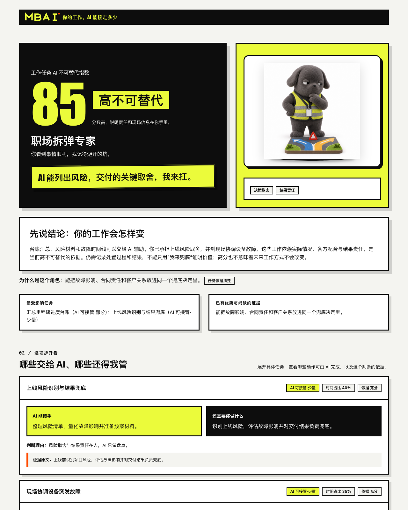
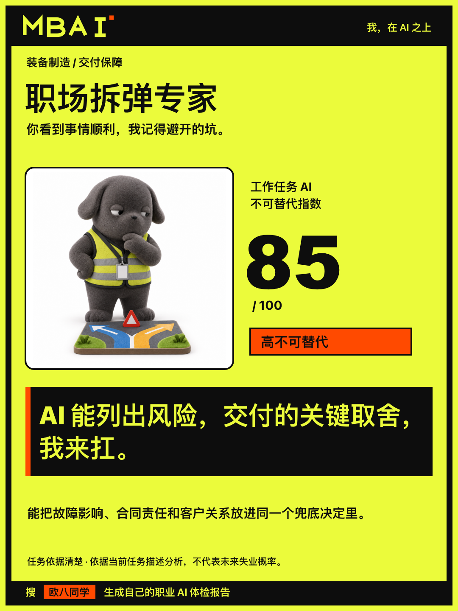

# MBAI · 工作任务 AI 不可替代指数

把一份简历交给 Claude Code，它会读出你具体做了哪些任务，逐条判断哪些可以交给 AI、哪些离不开你本人，最后生成一份离线 HTML 报告和一张 1080 × 1440 的脱敏分享卡。评分、校验、渲染全部由本地脚本完成，不需要任何在线服务。

MBAI（Me, Beyond AI · 我，在 AI 之上）是测评品牌名；正式指标名是「工作任务 AI 不可替代指数」——分数越高，说明你的工作越依赖你本人。

<p align="center">
  
  <br>
  
</p>

> 上图为演示素材，由 `examples/drafts/` 中的虚构案例生成，不含任何真实个人信息。

## 它怎么工作

1. 安装 Skill 到 Claude Code（见下方快速开始）。
2. 给它一份文字型 PDF、DOCX，或直接粘贴简历文本。
3. Claude 按冻结规则拆解任务并逐条评估；信息不足时最多补问 3 个问题，跳过就降低置信度继续。
4. 本地脚本完成契约校验、评分和渲染，产出离线 HTML 报告与 PNG 分享卡。命令行导出 PNG 需要 Chrome；没有 Chrome 时也可以直接在 HTML 页面里点按钮导出。

报告会告诉你：总指数与等级（低 / 中 / 高不可替代）、12 类工作方式角色（如「职场拆弹专家」）、哪些任务 AI 能接手、哪些还得你管、以及 7 天内可启动的行动。卡片只保留脱敏后的身份与结论，适合直接发朋友圈或社群。

## 快速开始

把仓库复制为 Claude Code 的个人技能目录：

```bash
git clone https://github.com/ouxxyy/mbai.git
mkdir -p ~/.claude/skills
cp -R mbai ~/.claude/skills/ai-task-exposure
```

重启一次 Claude Code 后，在会话里输入：

```text
/mbai /absolute/path/to/resume.pdf
```

或者直接说「用这份简历做工作任务 AI 不可替代指数诊断」。

环境要求：macOS（Apple Silicon）与 Python 3.11+。文字型 PDF 解析依赖系统 PDFKit/Swift；其他平台请改用 DOCX 或粘贴文本。可以用一条命令检查环境：

```bash
python3 scripts/check_env.py
```

## 开发者命令

运行完整测试（标准库 `unittest`，零第三方运行时依赖）：

```bash
python3 -m unittest discover -s tests -v
```

从 draft JSON 构建全套产物（最终 JSON、离线 HTML、PNG）：

```bash
python3 -m scripts.build_report --draft examples/drafts/risk-owner-showcase.json --output-dir examples/output/demo
```

版本单一来源在 `scripts/version.py`（当前 5.0.0）；冻结规则见 `docs/`，中间 JSON Schema 见 `references/`。

## 口径与边界

- 展示分 = 100 − 取整后替代分，唯一换算口径为先取整、后取补；分数越高越依赖本人。
- 这是本工具的自建解释性评分，不是失业概率、裁员预测，也不是任何研究机构的个人认证。研究设计参考了 ILO 的任务暴露视角与 Anthropic 首期实际使用观察，详见 [研究依据](references/research-basis.md)。
- 信息不足标 `UNKNOWN`，不当作低风险；可判断任务不足一半时不显示总指数。
- 扫描件、图片型 PDF、乱码或空文本不做猜测式 OCR，会明确请求文字版。
- 分享卡只能使用脱敏字段：姓名、联系方式、公司、学校、客户、项目名命中隐私门禁时必须返工。
- 渲染器只消费已验证的最终 JSON，不在 HTML 阶段重新分析。
- 请勿向本仓库提交真实简历；`examples/` 中全部为虚构验收数据。

## 作者

作者全平台同名：**欧八同学**。

- 微信公众号：扫码关注
- 抖音：[搜索"欧八同学"](https://www.douyin.com/search/%E6%AC%A7%E5%85%AB%E5%90%8C%E5%AD%A6)
- 小红书：[搜索"欧八同学"](https://www.xiaohongshu.com/search_result?keyword=%E6%AC%A7%E5%85%AB%E5%90%8C%E5%AD%A6)
- X：[搜索"欧八同学"](https://x.com/search?q=%E6%AC%A7%E5%85%AB%E5%90%8C%E5%AD%A6&src=typed_query)

<p align="center">
  
</p>

如果这个项目对你有用，欢迎点个 Star。遇到问题时，提交命令、报错和最小复现步骤就够了；请不要上传真实私人照片或简历。

## 许可证

本项目以 [CC BY-NC 4.0](LICENSE)（署名—非商业性使用 4.0 国际）协议发布：

- **不可商用**：不得将本项目或其改编版本用于商业目的（出售、付费服务、商业产品内置等）。
- **需保留原作者信息**：分享或修改本项目时，必须署名「欧八同学 / MBAI」、保留 LICENSE 文件，并注明原项目地址与是否修改过内容。
- MBAI 标识、角色形象与公众号二维码仅用于本项目原作者署名，移除或替换后不得再以 MBAI 名义分发。
